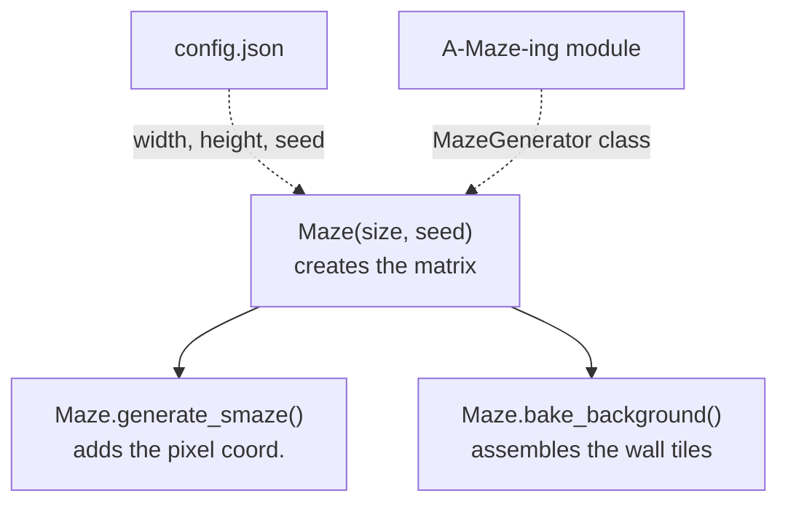
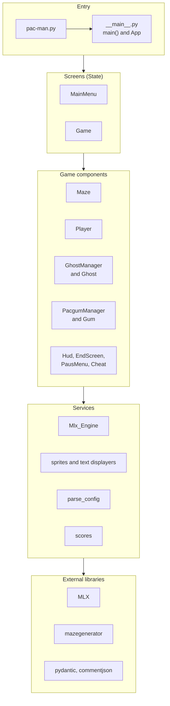
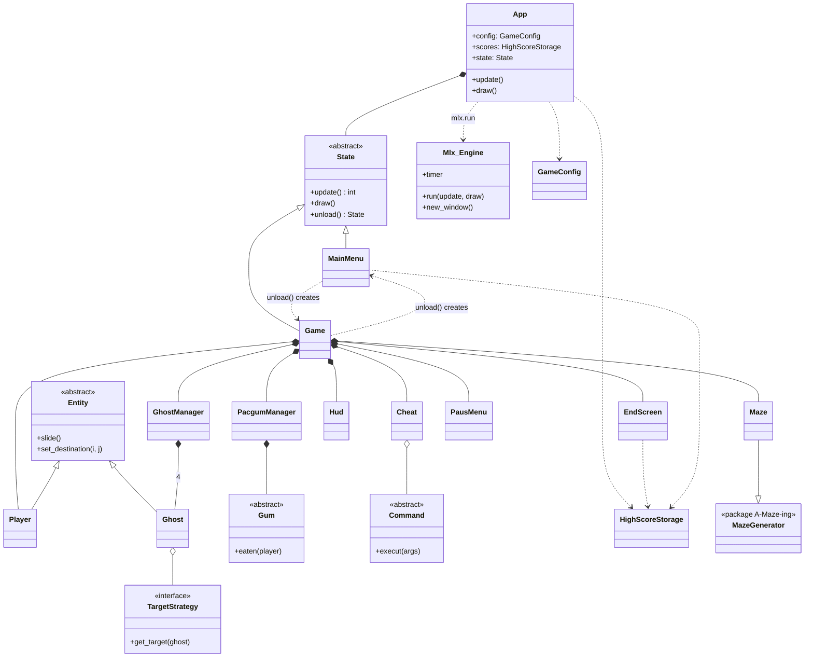

*This project has been created as part of the 42 curriculum by nbuchy, vadamavi.*

<div align="center">
  <video src="https://github.com/user-attachments/assets/f10c2c14-04ee-4d70-b54f-e00b73695834" width="470" height="386" autoplay muted loop playsinline></video>
  <p><sub>Source file : <a href="project_management/img/demo.mp4">project_management/img/demo.mp4</a></sub></p>
</div>

## Table of Contents

*To view the French version of this README*: [README_fr.md](project_management/doc/README_fr.md)

[1. Description](<#1-description>)
+ [1.1 Objective](<#objective>)
+ [1.2 Main requirements](<#main-requirements>)

[2. Instructions](<#2-instructions>)
+ [2.1 Requirements](<#requirements>)
+ [2.2 Installation](<#installation>)
+ [2.3 Run](<#run>)
+ [2.4 Packaging](<#packaging>)
+ [2.5 Makefile](<#makefile>)
+ [2.6 Game controls](<#game-controls>)

[3. Project](<#3-project>)
+ [3.1 Configuration](<#configuration>)
+ [3.2 High scores](<#high-scores>)
+ [3.3 Maze generation](<#maze-generation>)
+ [3.4 Implementation](<#implementation>)
+ [3.5 General software architecture](<#general-software-architecture>)
+ [3.6 Project management](<#project-management>)

[4. Resources](<#4-resources>)
+ [4.1 References](<#references>)
+ [4.2 AI usage](<#ai-usage>)

# 1/ Description

This project is inspired by **Pac-Man**, a classic arcade game from 1980: the player moves Pacman through a maze, has a limited time to eat all the pac-gums, and dies if they collide with a ghost. If they eat a super pac-gum, the ghosts become edible and briefly flee from them.

## Objective
The goal is to create and publish a complete game in Python (3.10+), using the MLX graphics library, Object-Oriented Programming and a modular, reusable architecture.

## Main requirements
+ A custom JSON configuration file (which may include comments), to define the game parameters.
+ Level generation based on the provided external package "A-Maze-ing".
+ A persistent high score system, e.g. a JSON file saved on disk.
+ A polished graphical interface, with a main menu, a game view and end-of-game handling.
+ A cheat mode intended for the evaluation.
+ A deployment on a public game platform, e.g. [itch.io](https://itch.io/), for demonstration purposes.

The code must:
+ include type hints and docstrings compliant with PEP 257,
+ be flake8 and mypy valid,
+ handle all errors gracefully.

*[Back to top](<#table-of-contents>)*

# 2/ Instructions

The project runs on Linux and WSL.  
The `mazegenerator` and `mlx` packages are imposed by the subject and provided in the `modules/` folder.

## Requirements

+ Python **3.10** and above
+ The package manager [uv](https://docs.astral.sh/uv/) which installs the necessary packages,
+ to run:
	+ `commentjson`
	+ `keysymdef`
	+ `mazegenerator`
	+ `mlx`
	+ `pydantic`
+ for development:
	+ `flake8`
	+ `mypy`
	+ `pytest`
+ for the build:
	+ `pyinstaller`


## Installation

```bash
git clone <repository-url> <directory>
cd <directory>

# to only install the game:
make install

# to install and launch the game:
make
```

## Run

The program must take **exactly one** argument, the path to his **JSON configuration file**:
```bash
# to use the file provided in `src/data/config.json`:
make run

# to use the file of your choice, e.g. `my_config` at the root of the project:
make run CONFIG=my_config.json
```

The program can also be launched by manually activating the virtual environment:
```bash
source .venv/bin/activate
python3 pac-man.py src/data/config.json
```

## Packaging

The game was packaged with PyInstaller, in `onedir` mode:
```text
dist
└── PacMan
    ├── PacMan
    └── _internal
        ├── assets
        │   └── ...
        ├── ...
        └── src
            └── data
                └── config.json
```
The `src/data/highscores.json` file was deliberately excluded from the package via `PacMan.spec`: a blank file will be created by the game as soon as the first score is recorded.

For the Itch.io release, the entire folder generated by PyInstaller (executable and its dependencies) was compressed into a .zip archive.  
Butler was not used for the upload because this project is not meant to receive updates.

The game can be downloaded at https://eclectik.itch.io/42-pacman with installation instructions, e.g. if the archive is extracted into a `pacman_itchio` folder:
```bash
cd pacman_itchio
# grant execution rights
chmod +x ./PacMan
# launch the game with the real path to the embedded config:
./PacMan _internal/src/data/config.json
# launch it with a fallback to the embedded config thanks to resolve_path():
./PacMan src/data/config.json
# launch it with a custom config:
./PacMan <anywhere/my_config.json>
```


## Makefile

Here are the commands included in the Makefile:

| Rule          | Description                                                                          |
| ------------- | ------------------------------------------------------------------------------------ |
| `all`         | `install` then `run`                                                                 |
| `install`     | Installs the project dependencies with `uv`                                          |
| `run`         | Runs the program (add `CONFIG=...` to choose the configuration file)                 |
| `debug`       | Runs the program with `pdb`                                                          |
| `test`        | Runs the `pytest` tests concerning parsing                                           |
| `lint`        | Runs `flake8 src` and `mypy src` with the required options                           |
| `lint-strict` | `lint`, with `mypy --strict`                                                         |
| `package`     | Creates the package in a `dist` folder                                               |
| `update`      | Updates the dependencies                                                             |
| `clean`       | Removes the caches and the `build` and `dist` folders                                |
| `fclean`      | `clean`, then removes the `.venv` virtual environment                                |


## Game controls

| Keys            | Actions                                                                                                                                          |
| --------------- | ------------------------------------------------------------------------------------------------------------------------------------------------ |
| `←` `↑` `↓` `→` | Pac-Man's direction (remembered until the next cell)                                                                           |
| `Esc`           | Pause menu during a game                                                                                                                         |
| `F3`            | Opens and closes the cheat console                                                                                                               |
| `help`          | in cheat mode, displays the available commands<br>(*The command manual is also provided in the file  [cheats.md](project_management/doc/cheats.md)*) |
| `tab`           | in cheat mode, recalls the previous command                                                                                                      |
| `Del`           | Closes the application                                                                                                                           |
| Mouse           | Menu buttons (hover and click)                                                                                                                   |

*[Back to top](<#table-of-contents>)*

# 3/ Project

## Configuration

The game is configured via a `config.json` file received as an argument. 

+ The configuration file can contain **comments**, if they start with `#` or `//`, full-line or inline:
  they will be ignored thanks to the `commentjson` library.

+ A **faulty** configuration file never causes a `traceback`:
  a valid `GameConfig` is always returned and used by the rest of the game.

+ Everything is **logged** with the `logging` module, configured at `INFO` level in `__main__.py`:
  the user is informed of each detected problem and how it was handled.

**Configuration example**, with the default values:
```json
{
    "highscore_filename": "src/data/default_scores.json",
    "lives": 3,
    "points_per_pacgum": 25
    "points_per_super_pacgum": 50,
    "points_per_ghost": 200,
    "seed": 42,
    "level_max_time": 300,
    "level": [
        {"id": 1, "width": 15, "height": 15},
        {"id": 2, "width": 15, "height": 15},
        {"id": 3, "width": 15, "height": 15},
        {"id": 4, "width": 15, "height": 15},
        {"id": 5, "width": 15, "height": 15},
        {"id": 6, "width": 15, "height": 15},
        {"id": 7, "width": 15, "height": 15},
        {"id": 8, "width": 15, "height": 15},
        {"id": 9, "width": 15, "height": 15},
        {"id": 10, "width": 15, "height": 15}
    ]
}
```

**Key descriptions**:

| Key                       | Type    | Description                                               |
| ------------------------- | ------- | --------------------------------------------------------- |
| `highscore_filename`      | string  | File used to persist the high scores                      |
| `lives`                   | integer | Lives at the start of a game                              |
| `points_per_pacgum`       | integer | Points for a pac-gum                                      |
| `points_per_super_pacgum` | integer | Points for a super pac-gum                                |
| `points_per_ghost`        | integer | Points for an edible ghost                                |
| `seed`                    | integer | Seed of the first level's maze                            |
| `level_max_time`          | integer | Time limit per level, in seconds                          |
| `level`                   | array   | List of levels, each with its own `id`, `width`, `height` |
| `level[].id`              | integer | id of this level                                          |
| `level[].width`           | integer | Maze width of this level                                  |
| `level[].height`          | integer | Maze height of this level                                 |

The rules validated by Pydantic and an example of logging/correction of a configuration are detailed in the appendix in [config.md](project_management/doc/config.md).


*[Back to top](<#table-of-contents>)*

## High scores

At the end of each game, so that the score is recorded, the player is asked to enter a username: 10 characters maximum, alphanumeric and spaces.

Scores are **saved** in a JSON file (chosen for its scalable structure, and ease of reading/writing in Python), in the form of a list of objects:
```json
[
    {
        "username": "xxx",
        "score": 000
    },
    ...
]
```

Errors when accessing this file (`src/data/highscores.json` for example) are logged and handled, and it is protected against corruption and interruptions during writing:
+ **Reading**  
  the (possibly empty) list of valid records is returned, a problematic file is never modified.
+ **Atomic writing**  
  writing is done in a temporary `.tmp` file, then renamed to the final file, in order to protect the original file in case of a crash during writing.
+ **Quarantine**  
  in case of a corrupted file, a copy `<file>.corrupt-YYYYMMDD-HHMMSS` is kept before any new write. Where applicable, valid records are preserved, and if the copy fails, the operation is cancelled to avoid losing this data.

The implementation of score management is detailed in the appendix in [scores.md](project_management/doc/scores.md).

*[Back to top](<#table-of-contents>)*


## Maze generation

The game implements no maze generation algorithm: it inherits from the `MazeGenerator` class of the **A-Maze-ing** module provided for the project and adds what concerns the display. As a precaution, the call to the generator has been placed in a `try`/`except`.



+ The validated configuration provides the size (`width` and `height`) of each level as well as the `seed` for the reproducibility of the mazes.
+ The generator's `PERFECT` parameter must absolutely be set to `False`, so that the mazes contain loops and form corridors compatible with the game.
+ The game uses no entrance, no exit and no path: Pac-Man appears in the center and the ghosts in the four corners, then the paths vary according to the ghosts' strategies.

### Using the grid

The matrix generated by `MazeGenerator` is a 2D grid, made up of cells and used by the rest of the game to detect the presence of walls.

+ A cell is a **4-bit integer** , where each bit is associated with a side and takes the value `1` when that side is closed by a wall:  North: `0b0001` ; East: `0b0010` ; South: `0b0100` ; West: `0b1000`. 
+ Our `Direction` class uses **the same values**, so that a simple binary test can check in which direction(s) Pacman and the ghosts can move, e.g.:
```python
# given a cell encoded with walls to the north and south: `0b0101`
if (code & Direction.EAST) == 0:
	...   # no wall to the east: we can go there
```
+ A cell with code `15` (`0b1111`) is surrounded by walls (pattern 42) and therefore inaccessible: it can contain no pac-gum and is never chosen as a target by a ghost.

### Display

Our `Maze` class converts the generated structure into screen coordinates and an MLX image:
+ to link the logical grid of cells `(i,j)` with the pixel display `(x,y)`,  `generate_smaze()` builds `smaze`, a grid where each cell knows its walls (`code`) and the pixel coordinates of its center (`coor`) ;
+ to reduce calls on each frame, a background image of the maze is built by assembling the tiles corresponding to the wall code of each cell.

### Level change

At each level, the `Maze` object is kept but re-generated with the size of the next level:
+ `Player`, `GhostManager`, `PacgumManager` hold a reference to this maze and automatically see the new grid;
+ `smaze` is recalculated;
+ a new background image is assembled and the old one destroyed.

*[Back to top](<#table-of-contents>)*

## Implementation

Some aspects of the implementation have already been presented:
+ The [packages](<#requirements>) used;
+ The [reading of the configuration](<#configuration>) and the [keeping of scores](<#high-scores>);

### Display and memory
The imposed use of **MiniLibX was the main challenge of this project**, because this graphics library is VERY minimalist: slow pixel-by-pixel display, rudimentary sprite handling, no physics handling...

- Images are loaded only once, when `src/utils/sprites.py` is imported, stored in dictionaries to be used by name, then they are freed at the end of the program by `second_impact()`.
- To limit as much as possible the number of calls on each frame, some images have been assembled into a single one: the maze drawing, the pacgum layer, the row of lives... Each composed image can thus be displayed in a single call per frame, and it is rebuilt only if its content changes. The appendix [bake_background.md](project_management/doc/bake_background.md) describes the principle of this assembly for the particular case of the background.
- Texts and numbers are assembled from sprites and cached, cf `src/utils/text_digit_displayer.py`.

### Real time and smoothness
So that the game keeps the same speed on a slow or fast machine, all movements and timers rely on a monotonic clock (`mlx.timer`, in seconds) rather than on a frame counter.  
As seen in the [Maze display](<#display>) section, the logic (walls, gums, ghost path) is computed on cells while the display uses pixels. To obtain a smooth movement between 2 cells, `Entity.slide()` computes the position by linear interpolation as a function of elapsed time.

### Main loop
`Mlx_Engine.run()` registers a function called continuously by MLX. On each call, it lets **16 ms** go by (about 60 frames per second), then executes in order:
 1. **`update()`**  
	 computes the new game situation (movements, collisions, score);
 2. **clearing** of the window  
    MLX always draws on top of what already exists, so we must start again from an empty window to avoid trails;
 3. **`draw()`**  
    redraws the whole current screen, from background to foreground;
 4. **synchronization** (`mlx_do_sync`)  
    sends all drawing orders to the graphics system and waits for them to be executed, so that the image is complete on screen before the next frame.

The application only knows these two functions, `App.update()` and `App.draw()`, which delegate to the current `State`.

### Screens
Each screen of the game (the menu, the game, etc.)  is a `State` object that works as follows:
+ it updates itself with `update()`, returning `1` when it is done;
+ it draws itself with `draw()`,
+ it closes its own window and creates the next screen with `unload()`.  
The application can thus go from `MainMenu` to `Game`, then back to `MainMenu`, etc.

Each screen has its own window and registers its own keyboard and mouse listeners there:
+ MainMenu listens to the mouse on the "MENU" window;
+ Game and its components listen to
	+ the keyboard on the "main" window (arrows, Esc, F3, username entry),
	+ the mouse during the pause.  
These listeners disappear with the window when unload() closes it, which prevents a screen from receiving the events of another.

Neither the pause nor the username entry at the end of the game are screens in their own right: they are small objects that `Game` enables or disables with a flag, so that `Game` is not destroyed during a pause and the game (maze, score, positions) stays in memory until it resumes.

### Ghosts
The `GhostManager` class coordinates the four ghosts: triggering and ending of flee mode, collisions, reset when Pac-Man loses a life.

Each ghost has its own movement strategies, applied according to its state (`GhostState` class):
+  `chase_strategy` in `CHASER` mode (pursuit);
+ `flee_strategy` in `FRIGHTENED` mode (flee);
+ `home_strategy` in `DEAD` mode (return to the corner and resurrection after 10 seconds).

To respect the `TargetStrategy` interface, all strategies implement the `get_target()` method which computes the coordinates of the target to reach. For example, for the pursuit:
+ `Blinky` aims directly at Pac-Man, with `PacmanTarget`;
+ `Pinky` aims 3 cells ahead of Pacman, with `NearbyTarget`;
+ `Inky` aims at the point symmetrical to Blinky with respect to 2 cells ahead of Pac-Man, with `TrickyTarget`;
+ `Clyde` wanders randomly and charges when Pac-Man is 3 cells away or less, with `RandomOrChargeTarget`.

Then the `A*`  algorithm uses the Manhattan distance to compute the shortest path. The choice of this algorithm and its implementation are explained in the appendix [Astar.md](project_management/doc/Astar.md).

### Relative paths
Path issues were solved by adding the file `src/utils/paths.py` which provides `ROOT_DIR`, `resource_path()` and  `resolve_path()`. So that the game always finds its `assets/` and its `.json` files, paths are computed from the location of the code (and not from the current folder), whether the game is launched from the sources or from the package.

### Cheat mode
To make the evaluation easier, a MAGNIFICENT `cheat` mode was implemented in the files `src/game/cheats/cheat.py` and `src/game/cheats/commands.py`.
+ The `Cheat` class allows enabling/disabling the console, reading the keyboard, parsing the typed line and executing it;
+ Each command inherits from the abstract class `Command`;
+ The `self.commands` dictionary allows a command lookup in O(1);
+ The last 6 commands are kept to be quickly recalled...
+ ... and visually we even have a blinking cursor based on `mlx.timer % 1 >= 0.5`!

*[Back to top](<#table-of-contents>)*

## General software architecture

The project models each concept of the game by a class that groups its data and behavior: `Player`, `Ghost`, `Maze`, `Hud`, `PacgumManager`, etc. 
#### Object-Oriented Programming
+ **Inheritance** factors out common code: `Player` and `Ghost` share the smooth movement of `Entity`, `Pacgum` and `SuperPacgum` inherit from `Gum`, and `Maze` extends the `MazeGenerator` class of the A-Maze-ing package. 
+ **Abstract classes** (`State`, `Entity`, `Gum`, `Command`, `TargetStrategy`) impose a contract that each subclass must respect. 
+ Thanks to **polymorphism**, `App` calls `update()` and `draw()` on any screen, `PacgumManager` calls `eaten()` on any gum, and each ghost gets its target with `get_target()` whatever its strategy. 
+ **Encapsulation** hides the details behind a simple interface: `Mlx_Engine` hides the graphics library, `HighScoreStorage` hides the scores file, and `HighScore` validates its own data at construction.

#### Modular and reusable architecture
+ The code is **split into modules** each with a clear responsibility: `menu/`, `game/` (with `entities/`, `gums/`, `cheats/`), `data/`... . Dependencies always go from top to bottom, a component like `Player` knows nothing about those that use it, which limits the impact of a modification.  
+ This organization **eases extension**: a new screen is one more class that inherits from `State`, a 5th ghost is a new targeting strategy, and a cheat command is one more class added to the commands dictionary.
+ Several **building blocks are reusable** in another project without modification: the `Mlx_Engine` engine, the safe score storage, the text-to-images display and the A\* pathfinding.





### Directory tree
```text
.
├── .gitignore
├── .python-version
├── Makefile
├── pac-man.py                           # Entry point to call `src.__main__.main()`
├── PacMan.spec
├── pyproject.toml
├── README.md
├── uv.lock
├── assets/                              # All assets needed by the game
│   ├── Background/
│   │   └── ...
│   ├── Entities/
│   │   └── ...
│   └── ...
├── project_management/                  # All documentation produced and shared during development
│   ├── subject_fr_v1.5.md
│   ├── todo.md
│   ├── Pacman.excalidraw
│   ├── repartition_taches.md
│   ├── planning.md
│   ├── img/
│   │   ├── demo.mp4
│   │   └── ...
│   └── doc/
│       ├── Astar.md
│       ├── bake_background.md
│       ├── cheats.md
│       ├── config.md
│       ├── git.md
│       ├── PyInstaller.md
│       ├── README_fr.md
│       ├── scores.md
│       ├── stub.md
│       ├── urls.md
│       └── ...
├── modules/                             # packages provided for the project
│   ├── mazegenerator-2.1.0-py3-none-any.whl
│   └── mlx-2.4-py3-none-any.whl
├── src/
│   ├── __init__.py
│   ├── __main__.py                      # Check args, get config, create `App`, start MLX loop
│   ├── Mlx.py                           # Shared rendering engine that encapsulates the MLX library
│   ├── state.py                         # `State` interface: `update()`, `draw()`, `unload()`
│   ├── data/                            # Valid config with Pydantic; Read/write high scores
│   │   ├── config.json
│   │   ├── highscores.json
│   │   ├── parse_config.py
│   │   └── scores.py
│   ├── game/                           # Everything that happens during a game
│   │   ├── __init__.py
│   │   ├── end_screen.py               # Enter name and record score
│   │   ├── game.py                     # Game screen (`State`) which brings everything together
│   │   ├── hud.py                      # In-game interface 
│   │   ├── maze.py                     # Maze: generation and display
│   │   ├── cheats/                     # Manage cheat mode 
│   │   │   ├── cheat.py
│   │   │   └── commands.py
│   │   ├── entities/                   # Pac-Man, ghosts : their manager and behaviour
│   │   │   ├── __init__.py
│   │   │   ├── entity.py
│   │   │   ├── ghost_characters.py
│   │   │   ├── ghost_manager.py
│   │   │   ├── ghost.py
│   │   │   ├── player.py
│   │   │   └── targets.py
│   │   └── gums/                       # Pac-gommes, Super Pac-gommes and their manager
│   │       ├── __init__.py
│   │       ├── gum.py
│   │       ├── pacgum_manager.py
│   │       ├── pacgum.py
│   │       └── super_pacgum.py
│   ├── menu/                           # In-game menus: home and pause screens.
│   │   ├── __init__.py
│   │   ├── main_menu.py
│   │   └── pause_menu.py
│   └── utils/
│       ├── directions.py               # Directions and movements
│       ├── paths.py                    # Calculate paths, to always locate assets and .json files
│       ├── sprites.py                  # Load all assets
│       ├── text_digit_displayer.py     # Display text and numbers
│       └── utils.py
├── stubs/                              # Description of the types of imported modules
│   └── mazegenerator
│       └── __init__.pyi
└── tests/                              # Unit tests with pytest
    └── test_parsing.py
```


### Classes




*[Back to top](<#project-description>)*

## Project management

**At the start**
+ Everyone chose the tasks they wanted to work on;
+ The project was framed via 2 files:
    + [ToDo list](project_management/todo.md)
    + [Pacman.excalidraw](project_management/Pacman.excalidraw)

**During development**
+ The code was shared via GitHub, with:
    + one branch per feature,
    + regular pull requests,
    + verbal communication when needed.  
This approach generated few conflicts, except for the `packaging` branch.

+ In parallel, thematic sheets were written and shared to help each pair get to grips with the other's code.

All these documents are available in the dedicated directory, [`project_management/`](project_management/).

*[Back to top](<#table-of-contents>)*

# 4/ Resources

## References

+ Visual elements for assets: [sprites](https://www.spriters-resource.com/arcade/pacman/)
+ MLX Python documentation: [MLX](https://github.com/noradefitero/42_MiniLibX_Python_Manual)
+ Official [uv](https://docs.astral.sh/uv/guides/projects/) documentation
+ Official [Pydantic](https://docs.pydantic.dev/) documentation
+ Short [commentjson](https://commentjson.readthedocs.io/en/latest/) documentation
+ Official [PyInstaller](https://pyinstaller.org/en/stable/operating-mode.html/) documentation
+ Official [Pytest](https://docs.pytest.org/en/stable/getting-started.html) documentation
+ Video [Ghost AI Explained](https://www.youtube.com/watch?v=ataGotQ7ir8)
+ Complete .fr guide [A* algorithm](https://www.datacamp.com/fr/tutorial/a-star-algorithm?dc_referrer=https%3A%2F%2Fwww.google.com%2F)
+ .en guide [A* algorithm](https://www.geeksforgeeks.org/python/a-search-algorithm-in-python/)


## AI usage

AI (GPT 5.6 and Sonnet 5.5) was used to:
+ Finalize the method that assembles all the maze tiles into a single background image (see [bake_background](project_management/doc/bake_background.md));
+ Finalize the packaging (update of the asset paths in `sprites.py`);
+ Write docstrings;
+ Fix `mypy` errors;
+ Generate the general architecture diagrams;
+ Translate this README into English.

*[Back to top](<#table-of-contents>)*
