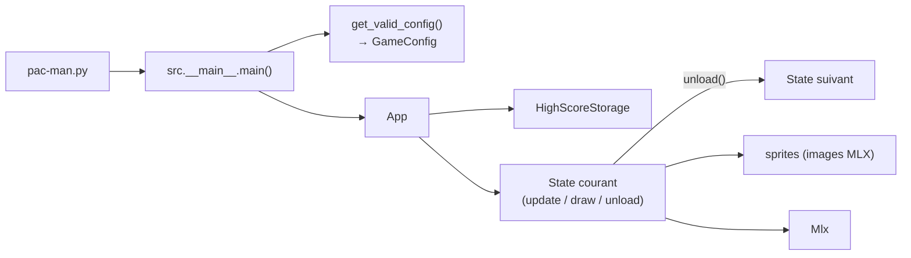

*This project has been created as part of the 42 curriculum by nbuchy, vadamavi.*

## Table of Contents

[1. Description](<#1-description>)  
DONE: *présente clairement le projet, y compris son objectif et un aperçu général.*
+ [1.1 Objectif](<#objectif>)
+ [1.2 Consignes principales](<#consignes-principales>)

[2. Instructions](<#2-instructions>)  
DONE: *toute information pertinente concernant la compilation, l'installation et/ou l'exécution.*  
ToDo: *maj url itch.io*
+ [2.1 Requirements](<#requirements>)
+ [2.2 Installation](<#installation>)
+ [2.3 Run](<#run>)
+ [2.4 Packaging](<#packaging>)
+ [2.5 Makefile](<#makefile>)
+ [2.6 Game controls](<#game-controls>)

[3. Projet](<#3-projet>)
+ [3.1 Configuration](<#configuration>)
+ [3.2 Meilleurs scores](<#meilleurs-scores>)
+ [3.3 Génération de labyrinthe](<#génération-de-labyrinthe>)
+ [3.4 Implémentation](<#implémentation>)
+ [3.5 Architecture logicielle générale](<#architecture-logicielle-générale>)
+ [3.6 Gestion de projet](<#gestion-de-projet>)

[4. Ressources](<#4-ressources>)

+ [4.1 Références](<#références>)
+ [4.2 Usage IA](<#usage-ia>)

# 1/ Description

Ce projet est inspiré de **Pac-Man**, un classique des jeux d'arcade de 1980 : le joueur déplace Pacman dans un labyrinthe, il dispose d'un temps limité pour manger toutes les pac-gommes et meurt s'il entre en collision avec un fantôme. S'il mange une super pac-gomme, les fantômes deviennent comestibles et le fuient brièvement.

## Objectif
Il s'agit de créer un jeu complet en Python (3.10+), en utilisant la bibliothèque graphique MLX, la Programmation Orientée Objet, une architecture modulaire et réutilisable, et de le publier sur une plateforme de jeux.

## Consignes principales
+ Un fichier JSON de configuration personnalisée (pouvant inclure des commentaires), pour définir les paramètres du jeu.
+ Une génération de niveaux basée sur le package externe fourni "A-Maze-ing".
+ Un système de meilleurs scores persistant, par ex. un fichier JSON sauvegardé sur le disque.
+ Une interface graphique soignée, avec menu principal, vue de jeu et gestion de la fin de partie.
+ Un mode triche destiné à l'évaluation.
+ Un déploiement sur une plateforme de jeu publique, par ex. Itch.io, à des fins de démonstration.

Le code doit :
+ inclure des type hints et docstrings conformes à la PEP 257,
+ être valide flake8 et mypy,
+ gérer proprement toutes les erreurs.

*[Back to top](<#table-of-contents>)*

# 2/ Instructions

Le projet fonctionne sous Linux et WSL. 
Les packages `mazegenerator` et `mlx` sont imposés par le sujet et fournis dans le dossier `modules/`.

## Requirements

+ Python **3.10** et supérieur
+ Le gestionnaire de paquets [`uv`](https://docs.astral.sh/uv/) qui installe les packages nécessaires :
+ pour fonctionner :
	+ `commentjson`
	+ `keysymdef`
	+ `mazegenerator`
	+ `mlx`
	+ `pydantic`
+ pour le développement :
	+ `flake8`
	+ `mypy`
	+ `pytest`
+ pour le build :
	+ `pyinstaller`


## Installation

```bash
git clone <repository-url> <directory>
cd <directory>

# pour seulement installer le jeu :
make install

# pour installer et lancer le jeu :
make
```

## Run

The program must take **exactly one** argument, the path to his JSON configuration file:
```bash
# pour utiliser le fichier fourni dans `src/data/config.json` :
make run

# pour utiliser le fichier de votre choix, par ex `my_config` à la racine du projet :
make run CONFIG=my_config.json
```

Le programme peut aussi être lancé en activant manuellement l'environnement virtuel :
```bash
source .venv/bin/activate
python3 pac-man.py src/data/config.json
```

## Packaging

Le jeu a été packagé avec PyInstaller, en mode `onedir` :
```text
dist
└── PacMan
    ├── PacMan
    └── _internal
        ├── assets
        │   └── ...
        ├── ...
        └── src
            └── data
                └── config.json
```
Le fichier `src/data/highscores.json` a volontairement été exclu du package via `PacMan.spec` : un fichier vierge sera créé par le jeu dès le 1er enregistrement d'un score.

Pour la mise en ligne sur Itch.io, l'intégralité du dossier généré par PyInstaller (exécutable et ses dépendances) a été compressé dans une archive .zip.
Butler n'a pas été utilisé pour l'upload car ce projet n'est pas censé recevoir des mises à jour.

Le jeu est téléchargeable à l'adresse https://eclectik.itch.io/42-pacman avec des instructions, par ex. si vous décompressez l'archive dans un dossier `pacman_io` :
```bash
cd pacman_io
chmod +x ./PacMan
# le lancer avec le chemin réel vers la config embarquée:
./PacMan _internal/src/data/config.json
# le lancer avec un repli sur la config embarquée grâce à resolve_path():
./PacMan src/data/config.json
# le lancer avec une config personnalisée :
./PacMan <anywhere/my_config.json>
```


## Makefile

Le projet inclut un Makefile avec les commandes suivantes :

| Règle         | Description                                                                          |
| ------------- | ------------------------------------------------------------------------------------ |
| `all`         | `install` puis `run`                                                                 |
| `install`     | Installe les dépendances du projet avec `uv`                                         |
| `run`         | Exécute le programme (`CONFIG=...` pour choisir le fichier de configuration)         |
| `debug`       | Exécute le programme en mode debug avec `pdb`                                        |
| `test`        | Lance les tests `pytest` (dossier `tests/`)                                          |
| `lint`        | Lance `flake8 src` et `mypy src --warn-return-any --warn-unused-ignores --ignore-missing-imports --disallow-untyped-defs --check-untyped-defs` |
| `lint-strict` | Idem `lint`, avec `mypy --strict` (non valide, voir [mypy.md](doc/mypy.md))          |
| `package`     | Crée le package dans le dossier `dist`                                               |
| `update`      | Met à jour les dépendances (`uv lock --upgrade`)                                     |
| `clean`       | Supprime les caches et les dossiers `build` et `dist`                                |
| `fclean`      | `clean`, puis supprime l'environnement virtuel `.venv`                               |


## Game controls

| Action             | Keys                          |
| ------------------ | ----------------------------- |
| Menu navigation    | Mouse Clic                    |
| Move Pacman        | `←` `↑` `↓` `→`               |
| Pause              | `Esc`                         |
| Cheat mode         | `F3`                          |
|   Display commands |   `help`                      |
|   ex: next level   |   `skip-level`                |

Toutes les commandes de cheat sont listées dans le fichier  [cheats.md](doc/cheats.md)


*[Back to top](<#table-of-contents>)*

# 3/ Projet

## Configuration
*ToDo: explique la structure du fichier de configuration et les valeurs par défaut.*

Le jeu est configuré via le fichier `config.json`. Les commentaires qui commencent par `#` ou `//`, full-line ou inline, sont ignorés grâce à la bibliothèque `commentjson`.

### Exemple de configuration
```json
// Pac-Man settings (default values)
{
    # High scores file, must end with .json
    "highscore_filename": "highscores.json",
    # Gameplay (all optional)
    "lives": 3,
    "points_per_pacgum": 10,
    "points_per_super_pacgum": 50,
    "points_per_ghost": 200,
    "seed": 42, // seed used for first-level reproducibility
    "level_max_time": 90,
    # at least 10 levels, with unique ids from 1 to 10
    "level": [
        {"id": 1, "width": 15, "height": 15},
        {"id": 2, "width": 15, "height": 15},
        {"id": 3, "width": 15, "height": 15},
        {"id": 4, "width": 15, "height": 15},
        {"id": 5, "width": 15, "height": 15},
        {"id": 6, "width": 15, "height": 15},
        {"id": 7, "width": 15, "height": 15},
        {"id": 8, "width": 15, "height": 15},
        {"id": 9, "width": 15, "height": 15},
        {"id": 10, "width": 15, "height": 15}
    ]
}
```


#### Description des clés
| Key                       | Type     | Description                                              |
| ------------------------- | -------- | -------------------------------------------------------- |
| `highscore_filename`      | string   | File used to persist the high scores                     |
| `lives`                   | integer  | Lives at the start of a game                             |
| `points_per_pacgum`       | integer  | Points for a pac-gum                                     |
| `points_per_super_pacgum` | integer  | Points for a super pac-gum                               |
| `points_per_ghost`        | integer  | Points for an edible ghost                               |
| `seed`                    | integer  | Seed of the first level's maze                           |
| `level_max_time`          | integer  | Time limit per level, in seconds                         |
| `level`                   | array    | List of levels, each with its own `id`, `width`, `height`|
| `level[].id`              | integer  | id of this level                                         |
| `level[].width`           | integer  | Maze width of this level                                 |
| `level[].height`          | integer  | Maze height of this level                                |

Les valeurs par défaut sont fournies dans l'exemple qui précède.

### Error handling

Un fichier de configuration défectueux ne provoque jamais de `traceback` : l'utilisateur est informé de chaque problème détecté et comment il a été géré.

Tout est journalisé avec le module `logging`, configuré au niveau `INFO` dans `__main__.py` :

+ `ERROR` : le nombre d'arguments reçus est différent de 1
=> le programme s'arrête avec le code de sortie `1`.
+ `WARNING` : le fichier est manquant, ou illisible (problème d'accès ou erreur de lecture)
=> la configuration par défaut est utilisée.
+ `WARNING` : la validation globale échoue, le JSON est syntaxiquement invalide
=> la configuration par défaut est utilisée.
+ `WARNING` : une valeur est invalide ou manquante
=> la valeur par défaut est utilisée.
+ `INFO` : une clé est inconnue
=> elle est ignorée.
+ `INFO` : une clé est manquante
=> elle est ajoutée avec sa valeur par défaut.

Le module `Pydantic` valide les contraintes suivantes :

+ `highscore_filename` : chaîne respectant la regex `^[a-zA-Z0-9_\-]+\.json$`
+ `lives` : entier > 0
+ `points_per_pacgum` : entier > 0
+ `points_per_super_pacgum` : entier > 0
+ `points_per_ghost` : entier > 0
+ `seed` : entier
+ `level_max_time` : entier > 0
+ `level` : liste de 10 éléments minimum ;
    et pour chaque élément :
    + `id` : entier à partir de 1, sans doublon et consécutifs
    + `width` : 3 <= entier <= 15
    + `height` : 3 <= entier <= 15

Un exemple de journalisation et de correction d'une configuration est détaillé en annexe dans [config.md](doc/config.md).

A NOTER : puisque `get_valid_config()` retourne toujours une `GameConfig` valide, le reste du jeu n'a jamais besoin de gérer une configuration incorrecte.


*[Back to top](<#table-of-contents>)*

## Meilleurs scores
*ToDo: explique le fonctionnement du système de meilleurs scores et pourquoi tu as choisi de l'implémenter ainsi.*


Les scores sont enregistrés dans un fichier JSON sous la forme d'une liste d'objets :
```json
[
    {
        "username": "xxx",
        "score": 000
    },
    ...
]
```
La classe `HighScoreStorage` gère la lecture et l'écriture de ce fichier (par défaut `src/data/highscores.py`), de façon que les 10 meilleurs scores soient conservés et que le jeu ne plante pas si ce fichier est endommagé.

### Lecture

+ fichier absent ou vide
=> liste de scores vide, sans erreur ;
+ JSON invalide, ou contenu qui n'est pas une liste
=> liste vide, fichier considéré comme corrompu ;
+ entrée invalide dans la liste
=> elle est ignorée (avec un avertissement `logging`), les entrées valides sont conservées.

### Écriture

+ **Écriture atomique** : la liste est d'abord écrite dans un fichier temporaire `.tmp`, puis renommé en fichier final. Ainsi, si le programme plante en cours d'écriture, le fichier d'origine reste intact ;

+ **Quarantaine** : avant d'écraser un fichier corrompu, une copie `<fichier>.corrupt-AAAAMMJJ-HHMMSS` est conservée. Si cette copie échoue, l'opération est annulée pour éviter de perdre ces données.

### Règles métier

*ToDo: vérifier les règles implémentées dans `add_score()` :
+ pseudo de 10 caractères maximum, alphanumérique et espaces ;
+ score entier positif ou nul ;
+ affichage des 10 meilleurs par ordre décroissant ;
+ départage des égalités.*


*ToDo: justifier le choix du format JSON, la séparation lecture/écriture
renvoyer vers [scores.md](doc/scores.md).*


*[Back to top](<#table-of-contents>)*


## Génération de labyrinthe
*ToDo: explique comment le package A-Maze-ing attribué est utilisé pour générer les labyrinthes.*

Les labyrinthes sont générés par le package **A-Maze-ing**, fourni pour le projet et dont la modification n'était pas autorisée.

+ Le module externe `MazeGenerator` génère la structure **logique** du labyrinthe (murs, chemins, entrée/sortie).
+ Le paramètre `PERFECT` du générateur doit impérativement être défini sur `False`, pour que les labyrinthes contiennent des boucles et forment des couloirs compatibles avec le jeu.
+ Le labyrinthe est reproductible grâce à une seed fixe (`42` par défaut).
+ La classe `Maze` gère la présentation : elle convertit la structure générée en coordonnées écran et en image MLX.
ToDo? *indiquer comment les dimensions `width` / `height` du niveau sont passées au générateur, et comment la structure de chaque case est convertie en l'une des 16 tuiles de murs (`assets/Walls/0000.png` à `1111.png`).*
ToDo? pour info, [bake_background.md](doc/bake_background.md) décrit l'assemblage des tuiles en une seule image d'arrière-plan.
ToDo: Si la génération d'un labyrinthe échoue, `?Komen kon gère?`.

*[Back to top](<#table-of-contents>)*

## Implémentation
*ToDo: résumé technique de ton implémentation.*


+ **Boucle principale** : `main()` valide la configuration, crée l'objet `App`, puis donne à MLX les méthodes `update()` et `draw()` de l'application (`mlx.run(app.update, app.draw)`). `App` ne contient qu'un état courant (`State`) : quand `update()` renvoie `1`, l'état courant est remplacé par celui que renvoie `unload()` (menu principal, partie, pause, fin de partie).
+ **Sprites** : toutes les images sont chargées une fois, à l'import de `src/utils/sprites.py`, et libérées à la fin du programme par `second_impact()`.
+ **Chemins** : `src/utils/paths.py` centralise la recherche des ressources, que le jeu soit lancé depuis les sources ou depuis le package (voir [Packaging](<#packaging>)).
+ **Fantômes** : l'algorithme `A*` fournit aux fantômes le chemin le plus court vers leur cible, qu'il s'agisse de Pac-Man, d'une cible aléatoire ou d'un point de repli. Le choix de cet algorithme et son implémentation sont [détaillés ici](doc/Astar.md).

*ToDo: ajouter
+ le comportement propre à chaque fantôme (`ghost_characters.py`),
+ choix des cibles (`targets.py`),
+ fonctionnement du mode « comestible », gestion du temps et des vies, points, collisions, mode triche.*

ToDo? *expliquer l'usage de [`dataclass(frozen=True)`](doc/dataclass_frozen_true.md)*
ToDo? *décrire les principales difficultés rencontrées.*

*[Back to top](<#table-of-contents>)*

## Architecture logicielle générale
*ToDo: vue d'ensemble de haut niveau de l'architecture logicielle (modules, classes, et leurs relations).*

Le module `src/utils/paths.py` permet de cibler les ressources (assets, configuration) aussi bien en développement que dans le package :
+ `resource_path()` localise une ressource à la racine du projet ou dans le dossier du package ;
+ `resolve_path()` s'en sert pour le fichier de configuration passé en argument.

### Vue d'ensemble

*ToDo: ce schéma ne montre que les relations visibles dans `__main__.py`. Le compléter avec les classes de `game/` (`Game`, `Maze`, entités, gommes, `HUD`, écran de fin) et préciser lesquelles dérivent de `State`.*



### Modules
† rôle déduit du nom des fichiers, à blablater :
| Module                              | Rôle                                                                |
| ----------------------------------- | ------------------------------------------------------------------- |
| `pac-man.py`                        | Point d'entrée à la racine, appelle `src.__main__.main()`           |
| `src/__main__.py`                   | Vérifie l'argument, valide la config, crée `App`, lance la boucle MLX |
| `src/Mlx.py`                        | Instance partagée `mlx` (fenêtre, boucle, chargement d'images)      |
| `src/state.py`                      | Interface `State` : `update()`, `draw()`, `unload()`                |
| `src/data/parse_config.py`          | `get_valid_config()` : lecture et validation (Pydantic) de la config |
| `src/data/scores.py`                | `HighScoreStorage` : lecture / écriture des meilleurs scores        |
| `src/utils/paths.py`                | `ROOT_DIR`, `resource_path()`, `resolve_path()`                     |
| `src/utils/sprites.py`              | Chargement et libération de toutes les images                       |
| `src/utils/text_digit_displayer.py` | Affichage de texte et de nombres †                                  |
| `src/utils/directions.py`           | Énumération des directions †                                        |
| `src/game/game.py`                  | Logique d'une partie †                                              |
| `src/game/maze.py`                  | Labyrinthe : génération et affichage                                |
| `src/game/hud.py`, `end_screen.py`  | Affichage des vies / scores, écran de fin de partie †               |
| `src/game/entities/`                | Pac-Man, fantômes et leur comportement (`targets.py`, A*) †         |
| `src/game/gums/`                    | Pac-gommes, super pac-gommes et leur gestionnaire †                 |
| `src/game/cheats/`                  | Mode triche (`cheat.py`, `commands.py`) †                           |
| `src/menu/`                         | Menu principal et menu pause †                                      |


```text
.
├── .gitignore
├── .python-version
├── Makefile
├── pac-man.py
├── PacMan.spec
├── pyproject.toml
├── README.md
├── uv.lock
├── assets/
│   ├── Background/
│   │   └── ...
│   ├── Entities/
│   │   └── ...
│   └── ...
├── doc/
│   ├── Astar.md
│   ├── bake_background.md
│   ├── config.md
│   ├── dataclass_frozen_true.md
│   ├── git.md
│   ├── Pacman.excalidraw
│   ├── PyInstaller.md
│   ├── scores.md
│   ├── subject_fr_v1.5.md
│   ├── todo.md
│   └── urls.md
├── modules/
│   ├── mazegenerator-2.1.0-py3-none-any.whl
│   └── mlx-2.4-py3-none-any.whl
├── src/
│   ├── __init__.py
│   ├── __main__.py
│   ├── Mlx.py
│   ├── state.py
│   ├── data/
│   │   ├── config.json
│   │   ├── highscores.json
│   │   ├── parse_config.py
│   │   └── scores.py
│   ├── game/
│   │   ├── __init__.py
│   │   ├── end_screen.py
│   │   ├── game.py
│   │   ├── hud.py
│   │   ├── maze.py
│   │   ├── cheats/
│   │   │   ├── cheat.py
│   │   │   └── commands.py
│   │   ├── entities/
│   │   │   ├── __init__.py
│   │   │   ├── entity.py
│   │   │   ├── ghost_characters.py
│   │   │   ├── ghost_manager.py
│   │   │   ├── ghost.py
│   │   │   ├── player.py
│   │   │   └── targets.py
│   │   └── gums/
│   │       ├── __init__.py
│   │       ├── gum.py
│   │       ├── pacgum_manager.py
│   │       ├── pacgum.py
│   │       └── super_pacgum.py
│   ├── menu/
│   │   ├── __init__.py
│   │   ├── main_menu.py
│   │   └── pause_menu.py
│   └── utils/
│       ├── directions.py
│       ├── paths.py
│       ├── sprites.py
│       ├── text_digit_displayer.py
│       └── utils.py
└── tests/
    └── test_parsing.py
```

*[Back to top](<#project-description>)*

## Gestion de projet
*ToDo: bref aperçu de la façon dont tu as géré le projet
et un lien vers le répertoire dédié à la gestion de projet.*

Au démarrage :
+ chacun a choisi les tâches sur lesquelles il souhaitait travailler ;
+ le projet a été cadré via ces 2 fichiers, régulièrement mis à jour ensuite :
    + [ToDo list](doc/todo.md)
    + [Pacman.excalidraw](doc/Pacman.excalidraw)

Le code a été partagé via GitHub, avec une branche par fonctionnalité, des pull requests régulières et une communication orale le cas échéant. 
ToDo? *Les conventions et ModOp Git utilisés sont décrits dans [git.md](doc/git.md).*

A noter: le merge de la première branche de packaging a généré suffisamment de conflits pour justifier son annulation et la création d'une nouvelle branche dédiée.
ToDo? *quel enseignement pour la suite ?*
ToDo? *préciser les règles de la branche `main` (revues, protection).*


Les documents de gestion du projet sont disponibles dans le répertoire dédié, [`doc/`](doc/).

*[Back to top](<#table-of-contents>)*

# 4/ Ressources

## Références
*ToDo: références classiques liées au sujet (documentation, articles, tutoriels, etc.)*

Des ressources ont été rassemblées et partagées via un fichier [urls.md](doc/urls.md)

ToDo: lister qq références principales avec une courte description :
+ le sujet ([subject_fr_v1.5.md](doc/subject_fr_v1.5.md)),
+ documentation de MLX,
+ de Pydantic,
+ de `commentjson`,
+ de PyInstaller,
+ d'`uv`,
+ article de référence sur A*,
+ ressources sur le comportement des fantômes de Pac-Man.


## Usage IA
*ToDo: description de la manière dont l'IA a été utilisée : pour quelles tâches et quelles parties du projet.*

L'IA Claude (sonnet 5.5) a été utilisée pour :
+ finaliser la méthode qui assemble toutes les tuiles du labyrinthe en 1 seule image d'arrière-plan (voir [bake_background](doc/bake_background.md)) ;
+ finaliser le packaging (mise à jour des chemins vers les assets dans `sprites.py`) ;
+ rédiger des docstrings ;
+ corriger des erreurs `mypy` ;
+ traduire ce ReadMe en anglais.

*[Back to top](<#table-of-contents>)*