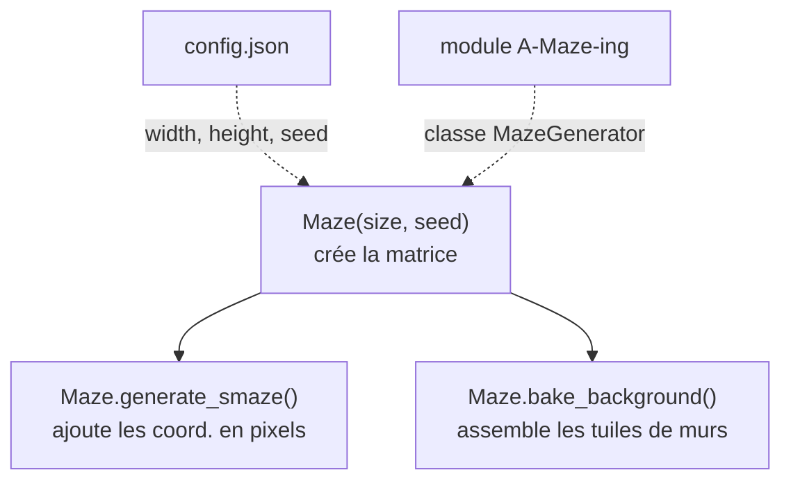
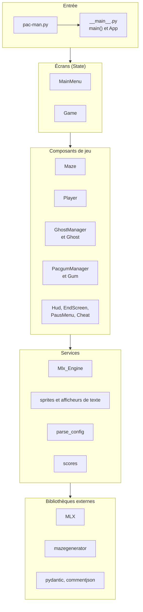
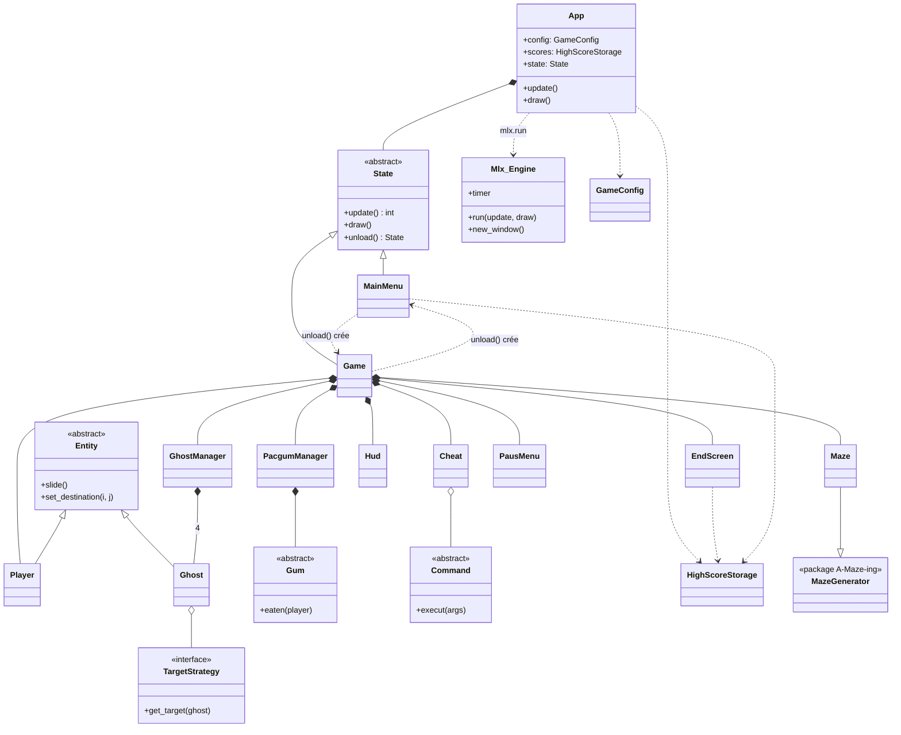

*This project has been created as part of the 42 curriculum by nbuchy, vadamavi.*

##### test with private repo
<div align="center">
  <video src="https://github.com/user-attachments/assets/57f40ba0-2405-4093-8c26-42423b1e5398" width="470" height="386" autoplay muted loop playsinline></video>
</div>

<div align="center">
  <video src="doc/img/demo.mp4" width="470" height="386" autoplay muted loop playsinline></video>
</div>


## Table of Contents

[1. Description](<#1-description>)
+ [1.1 Objectif](<#objectif>)
+ [1.2 Consignes principales](<#consignes-principales>)

[2. Instructions](<#2-instructions>)
+ [2.1 Requirements](<#requirements>)
+ [2.2 Installation](<#installation>)
+ [2.3 Run](<#run>)
+ [2.4 Packaging](<#packaging>)
+ [2.5 Makefile](<#makefile>)
+ [2.6 Game controls](<#game-controls>)

[3. Projet](<#3-projet>)
+ [3.1 Configuration](<#configuration>)
+ [3.2 Meilleurs scores](<#meilleurs-scores>)
+ [3.3 Génération de labyrinthe](<#génération-de-labyrinthe>)
+ [3.4 Implémentation](<#implémentation>)
+ [3.5 Architecture logicielle générale](<#architecture-logicielle-générale>)
+ [3.6 Gestion de projet](<#gestion-de-projet>)

[4. Ressources](<#4-ressources>)
+ [4.1 Références](<#références>)
+ [4.2 Usage IA](<#usage-ia>)

# 1/ Description

Ce projet est inspiré de **Pac-Man**, un classique des jeux d'arcade de 1980 : le joueur déplace Pacman dans un labyrinthe, il dispose d'un temps limité pour manger toutes les pac-gommes et meurt s'il entre en collision avec un fantôme. S'il mange une super pac-gomme, les fantômes deviennent comestibles et le fuient brièvement.

## Objectif
Il s'agit de créer et publier un jeu complet en Python (3.10+), en utilisant la bibliothèque graphique MLX, la Programmation Orientée Objet et une architecture modulaire et réutilisable.

## Consignes principales
+ Un fichier JSON de configuration personnalisée (pouvant inclure des commentaires), pour définir les paramètres du jeu.
+ Une génération de niveaux basée sur le package externe fourni "A-Maze-ing".
+ Un système de meilleurs scores persistant, par ex. un fichier JSON sauvegardé sur le disque.
+ Une interface graphique soignée, avec menu principal, vue de jeu et gestion de la fin de partie.
+ Un mode triche destiné à l'évaluation.
+ Un déploiement sur une plateforme de jeu publique, par ex. Itch.io, à des fins de démonstration.

Le code doit :
+ inclure des type hints et docstrings conformes à la PEP 257,
+ être valide flake8 et mypy,
+ gérer proprement toutes les erreurs.

*[Back to top](<#table-of-contents>)*

# 2/ Instructions

Le projet fonctionne sous Linux et WSL. 
Les packages `mazegenerator` et `mlx` sont imposés par le sujet et fournis dans le dossier `modules/`.

## Requirements

+ Python **3.10** et supérieur
+ Le gestionnaire de paquets [`uv`](https://docs.astral.sh/uv/) qui installe les packages nécessaires,
+ pour fonctionner :
	+ `commentjson`
	+ `keysymdef`
	+ `mazegenerator`
	+ `mlx`
	+ `pydantic`
+ pour le développement :
	+ `flake8`
	+ `mypy`
	+ `pytest`
+ pour le build :
	+ `pyinstaller`


## Installation

```bash
git clone <repository-url> <directory>
cd <directory>

# pour seulement installer le jeu :
make install

# pour installer et lancer le jeu :
make
```

## Run

The program must take **exactly one** argument, the path to his **JSON configuration file**:
```bash
# pour utiliser le fichier fourni dans `src/data/config.json` :
make run

# pour utiliser le fichier de votre choix, par ex `my_config` à la racine du projet :
make run CONFIG=my_config.json
```

Le programme peut aussi être lancé en activant manuellement l'environnement virtuel :
```bash
source .venv/bin/activate
python3 pac-man.py src/data/config.json
```

## Packaging

Le jeu a été packagé avec PyInstaller, en mode `onedir` :
```text
dist
└── PacMan
    ├── PacMan
    └── _internal
        ├── assets
        │   └── ...
        ├── ...
        └── src
            └── data
                └── config.json
```
Le fichier `src/data/highscores.json` a volontairement été exclu du package via `PacMan.spec` : un fichier vierge sera créé par le jeu dès le 1er enregistrement d'un score.

Pour la mise en ligne sur Itch.io, l'intégralité du dossier généré par PyInstaller (exécutable et ses dépendances) a été compressé dans une archive .zip.
Butler n'a pas été utilisé pour l'upload car ce projet n'est pas censé recevoir des mises à jour.

Le jeu est téléchargeable à l'adresse https://eclectik.itch.io/42-pacman avec des instructions pour l'installation, par ex. si l'archive est décompressée dans un dossier `pacman_itchio` :
```bash
cd pacman_itchio
# attribuer les droits d'exécution
chmod +x ./PacMan
# lancer le jeu avec le chemin réel vers la config embarquée:
./PacMan _internal/src/data/config.json
# le lancer avec un repli sur la config embarquée grâce à resolve_path():
./PacMan src/data/config.json
# le lancer avec une config personnalisée :
./PacMan <anywhere/my_config.json>
```


## Makefile

Voici les commandes inclues dans le Makefile  :

| Règle         | Description                                                                          |
| ------------- | ------------------------------------------------------------------------------------ |
| `all`         | `install` puis `run`                                                                 |
| `install`     | Installe les dépendances du projet avec `uv`                                         |
| `run`         | Exécute le programme (ajouter `CONFIG=...` pour choisir le fichier de configuration) |
| `debug`       | Exécute le programme avec `pdb`                                                      |
| `test`        | Lance les tests `pytest` concernant le parsing                                       |
| `lint`        | Lance `flake8 src` et `mypy src` avec les options imposées                           |
| `lint-strict` | `lint`, avec `mypy --strict`                                                         |
| `package`     | Crée le package dans un dossier `dist`                                               |
| `update`      | Met à jour les dépendances                                                           |
| `clean`       | Supprime les caches et les dossiers `build` et `dist`                                |
| `fclean`      | `clean`, puis supprime l'environnement virtuel `.venv`                               |


## Game controls

| Keys            | Actions                                                                                                                                          |
| --------------- | ------------------------------------------------------------------------------------------------------------------------------------------------ |
| `←` `↑` `↓` `→` | Direction de Pac-Man (mémorisée jusqu'au prochain croisement possible)                                                                           |
| `Échap`         | Menu pause pendant une partie                                                                                                                    |
| `F3`            | Ouvre et ferme la console de cheat                                                                                                               |
| `help`          | en mode cheat, affiche les commandes disponibles<br>(*Le manuel des commandes est également fourni dans le fichier  [cheats.md](doc/cheats.md)*) |
| `tabulation`    | en mode cheat, rappelle la commande précédente                                                                                                   |
| `Suppr`         | Ferme l'application                                                                                                                              |
| Souris          | Boutons des menus (survol et clic)                                                                                                               |

*[Back to top](<#table-of-contents>)*

# 3/ Projet

## Configuration

Le jeu est configuré via un fichier `config.json` reçu en argument. 

+ Le fichier de configuration peut contenir des **commentaires**, s'ils commencent par `#` ou `//`, full-line ou inline :
  ils seront ignorés grâce à la bibliothèque `commentjson`.

+ Un fichier de configuration **défectueux** ne provoque jamais de `traceback` :
  une `GameConfig` valide est toujours retournée et utilisée par le reste du jeu.

+ Tout est **journalisé** avec le module `logging`, configuré au niveau `INFO` dans `__main__.py` :
  l'utilisateur est informé de chaque problème détecté et comment il a été géré.

**Exemple de configuration**, avec les valeurs par défaut :
```json
{
    "highscore_filename": "highscores.json",
    "lives": 3,
    "points_per_pacgum": 10,
    "points_per_super_pacgum": 50,
    "points_per_ghost": 200,
    "seed": 42,
    "level_max_time": 90,
    "level": [
        {"id": 1, "width": 15, "height": 15},
        {"id": 2, "width": 15, "height": 15},
        {"id": 3, "width": 15, "height": 15},
        {"id": 4, "width": 15, "height": 15},
        {"id": 5, "width": 15, "height": 15},
        {"id": 6, "width": 15, "height": 15},
        {"id": 7, "width": 15, "height": 15},
        {"id": 8, "width": 15, "height": 15},
        {"id": 9, "width": 15, "height": 15},
        {"id": 10, "width": 15, "height": 15}
    ]
}
```

**Description des clés** :

| Key                       | Type    | Description                                               |
| ------------------------- | ------- | --------------------------------------------------------- |
| `highscore_filename`      | string  | File used to persist the high scores                      |
| `lives`                   | integer | Lives at the start of a game                              |
| `points_per_pacgum`       | integer | Points for a pac-gum                                      |
| `points_per_super_pacgum` | integer | Points for a super pac-gum                                |
| `points_per_ghost`        | integer | Points for an edible ghost                                |
| `seed`                    | integer | Seed of the first level's maze                            |
| `level_max_time`          | integer | Time limit per level, in seconds                          |
| `level`                   | array   | List of levels, each with its own `id`, `width`, `height` |
| `level[].id`              | integer | id of this level                                          |
| `level[].width`           | integer | Maze width of this level                                  |
| `level[].height`          | integer | Maze height of this level                                 |

Les règles validées par Pydantic et un exemple de journalisation/correction d'une configuration sont détaillés en annexe dans [config.md](doc/config.md).


*[Back to top](<#table-of-contents>)*

## Meilleurs scores

A chaque fin de partie, afin que le score soit enregistré, le joueur est amené à saisir un pseudo : 10 caractères maximum, alphanumériques et espaces.

Les scores sont **sauvegardés** dans un fichier JSON (choisi pour sa structure évolutive, et facile à lire/écrire en Python), sous la forme d'une liste d'objets :
```json
[
    {
        "username": "xxx",
        "score": 000
    },
    ...
]
```

Les erreurs d'accès à ce fichier (`src/data/highscores.json` par défaut) sont journalisées et gérées, il est protégé contre la corruption et les coupures en cours d’écriture :
+ **Lecture**  
  la liste (éventuellement vide) des enregistrements valides est retournée, un fichier problématique n'est jamais modifié.
+ **Écriture atomique**  
  l'écriture se fait dans un fichier temporaire `.tmp`, renommé ensuite en fichier final , afin de protéger le fichier d'origine en cas de plantage en cours d'écriture.
+ **Quarantaine**  
  en cas de fichier corrompu, une copie `<fichier>.corrupt-AAAAMMJJ-HHMMSS` est conservée avant toute nouvelle écriture. Le cas échéant les enregistrements valides sont conservés, et si la copie échoue, l'opération est annulée pour éviter de perdre ces données.

L'implémentation de la gestion des scores est détaillée en annexe dans [scores.md](doc/scores.md).

*[Back to top](<#table-of-contents>)*


## Génération de labyrinthe

Le jeu n'implémente aucun algorithme de génération de labyrinthe : il hérite de la classe `MazeGenerator` du module **A-Maze-ing** fourni pour le projet et lui ajoute ce qui concerne l'affichage. Par précaution, l'appel au générateur a été placé dans un `try`/`except`.



+ La configuration validée fournit la taille (`width` et `height`) de chaque niveau ainsi que la graine `seed` pour la reproductibilité des labyrinthes.
+ Le paramètre `PERFECT` du générateur doit impérativement être défini sur `False`, pour que les labyrinthes contiennent des boucles et forment des couloirs compatibles avec le jeu.
+ Le jeu n'utilise ni entrée, ni sortie, ni chemin : Pac-Man apparaît au centre et les fantômes dans les quatre coins, les chemins varient selon les stratégies des fantômes.

### Utilisation de la grille

La matrice générée par `MazeGenerator` est une grille 2D, qui est composée de cellules et qui est utilisée par le reste du jeu pour détecter la présence de murs.

+ Une cellule est un **entier de 4 bits** , où chaque bit est associé à un côté et prend la valeur `1` quand quand ce côté est fermé par un mur :  Nord: `0b0001` ; Est: `0b0010` ; Sud: `0b0100` ; Ouest: `0b1000`. 
+ Notre classe `Direction` utilise **les mêmes valeurs**, afin qu'un simple test binaire permette de vérifier dans quelle(s) direction(s) Pacman et les fantômes peuvent se déplacer, par ex :
```python
# soit une cellule codée avec des murs au nord et au sud : `0b0101`
if (code & Direction.EAST) == 0:
	...   # pas de mur à l'est : on peut y aller
```
+ Une cellule de code `15` (`0b1111`) est cernée de murs (pattern 42) et donc inaccessible : elle ne pourra contenir aucune pacgum et n'est jamais choisie comme cible par un fantôme.

### Affichage

Notre classe `Maze` convertit la structure générée en coordonnées écran et en image MLX :
+ pour faire le lien entre la grille logique en cases `(i,j)` et l'affichage en pixels `(x,y)`,  `generate_smaze()` construit `smaze`, une grille où chaque cellule connait ses murs (`code`) et les coordonnées en pixels de son centre (`coor`) ;
+ pour réduire les appels à chaque frame, une image de fond du labyrinthe est construite en assemblant les tuiles correspondant au code des murs de chaque cellule.

### Changement de niveau

À chaque niveau, l'objet `Maze` est conservé mais re-généré avec la taille du niveau suivant :
+ `Player`, `GhostManager`, `PacgumManager` détiennent une référence vers ce labyrinthe et voient automatiquement la nouvelle grille ;
+ `smaze` est recalculé ;
+ une nouvelle image de fond est assemblée et l'ancienne détruite.

*[Back to top](<#table-of-contents>)*

## Implémentation

Certains aspects de l'implémentation ont déjà été présentés :
+ Les [packages](<#requirements>) utilisés ;
+ La [lecture de la configuration](<#configuration>) et la [conservation des scores](<#meilleurs-scores>) ;

### Affichage et mémoire
L'utilisation imposée de la MiniLibX était le principal défi de ce projet, car cette bibliothèque graphique est TRÈS minimaliste : affichage pixel par pixel lent, gestion rudimentaire des sprites, aucune gestion de la physique...

- Les images sont chargées une seule fois, à l'import de `src/utils/sprites.py`, rangées dans des dictionnaires elles utilisées par leur nom, puis elles sont libérées à la fin du programme par `second_impact()`.
- Pour limiter autant que possible le nombre d'appels à chaque frame, certaines images ont été assemblées en une seule : le dessin du labyrinthe, la couche de pacgums, la rangée de vies... Chaque image composée peut ainsi être affichée en un seul appel par frame, et elle n'est reconstruite que si son contenu change. L'annexe [bake_background.md](doc/bake_background.md) décrit le principe de cet assemblage pour le cas particulier du background.
- Les textes et nombres sont assemblés à partir de sprites et mis en cache, cf `src/utils/text_digit_displayer.py`.

### Temps réel et fluidité
Pour que le jeu garde la même vitesse sur une machine lente ou rapide, tous les mouvements et chronomètres s'appuient sur une horloge monotone (`mlx.timer`, en secondes) plutôt que sur un compteur d'image.  
Comme vu à la rubrique [Affichage du labyrinthe](<#affichage>), la logique (murs, gommes, chemin des fantômes) se calcule sur les cases tandis que l'affichage utilise les pixels. Pour obtenir un déplacement fluide entre 2 cases, `Entity.slide()` calcule la position par interpolation linéaire en fonction du temps écoulé.

### Boucle principale
`Mlx_Engine.run()` enregistre une fonction appelée en continu par MLX. À chaque appel, elle laisse passer **16 ms** (environ 60 images par seconde), puis exécute dans l'ordre :
 1. **`update()`**
	 calcule la nouvelle situation du jeu (déplacements, collisions, score) ;
 2. **effacement** de la fenêtre
    MLX dessine toujours par-dessus ce qui existe déjà, il faut donc repartir d’une fenêtre vide pour éviter les traînées ;
 3. **`draw()`**
    redessine tout l’écran courant, de l’arrière-plan vers l’avant-plan ;
 4. **synchronisation** (`mlx_do_sync`)
    envoie tous les ordres de dessin au système graphique et attend qu’ils soient exécutés, pour que l’image soit complète à l’écran avant la frame suivante.

L'application ne connaît que ces deux fonctions, `App.update()` et `App.draw()`, qui délèguent au `State` courant.

### Ecrans
Chaque écran du jeu (le menu, la partie, etc.)  est un objet `State` qui fonctionne ainsi :
+ se met à jour avec `update()`, en renvoyant `1` quand il a fini ;
+ se dessine avec `draw()`,
+ ferme sa propre fenêtre et crée l’écran suivant avec `unload()`.
L'application peut passer ainsi de `MainMenu` à `Game`, puis de nouveau à `MainMenu`, etc.

Ni la pause ni la saisie du pseudo en fin de partie ne sont des écrans à part entière : ce sont de petits objets que `Game` active ou désactive avec un drapeau, afin que que `Game` ne soit pas détruit pendant une pause et que la partie (labyrinthe, score, positions) reste en mémoire jusqu’à la reprise.

### Fantômes
La classe `GhostManager` coordonne les quatre fantômes : déclenchement et fin du mode fuite, collisions, reset quand Pac-Man perd une vie.

Chaque fantôme dispose de ses propres stratégies de déplacement, appliquées selon son état (classe `GhostState`) :
+  `chase_strategy` en mode `CHASER` (poursuite) ;
+ `flee_strategy` en mode `FRIGHTENED` (fuite) ;
+ `home_strategy` en mode `DEAD` (retour au coin et résurrection après 10 secondes).

Pour respecter l'interface `TargetStrategy`, toutes les stratégies implémentent la méthode `get_target()` qui calcule les coordonnées de la cible à atteindre. Par exemple, pour la  poursuite :
+ `Blinky` vise directement Pac-Man, avec `PacmanTarget` ;
+ `Pinky` vise 3 cases devant Pacman, avec `NearbyTarget` ;
+ `Inky` vise le symétrique de Blinky par rapport à 2 cases devant Pac-Man, avec `TrickyTarget` ;
+ `Clyde` erre au hasard et charge quand Pac-Man se trouve à 3 cases ou moins, avec `RandomOrChargeTarget`.

Ensuite l'algorithme `A*`  utilise la distance de Manhattan pour calculer le chemin le plus court. Le choix de cet algorithme et son implémentation sont expliqués dans l'annexe [Astar.md](doc/Astar.md).

### Chemins relatifs
Les problèmes de chemins ont été résolus par l'ajout du fichier `src/utils/paths.py` qui fournit `ROOT_DIR`, `resource_path()` et  `resolve_path()`. Afin que le jeu trouve toujours ses `assets/` et ses `.json`, les chemins sont calculés à partir de l'emplacement du code (et non du dossier courant), que le jeu soit lancé depuis les sources ou depuis le package.

### Mode triche
Pour faciliter la correction, un MAGNIFIQUE mode `cheat` a été implémenté dans les fichiers `src/game/cheats/cheat.py` et `src/game/cheats/commands.py`.
+ La classe `Cheat` permet d'activer/désactiver la console, lire le clavier, analyser la ligne saisie et l'exécuter ;
+ Chaque commande hérite de la classe abstraite `Command` ;
+ Le dictionnaire `self.commands` permet une recherche de commande en O(1) ;
+ Les 6 dernières commandes sont conservées pour être rappelées rapidement...
+ ... et visuellement on a même un curseur clignotant basé sur `mlx.timer % 1 >= 0.5` !

*[Back to top](<#table-of-contents>)*

## Architecture logicielle générale

Le projet modélise chaque concept du jeu par une classe qui regroupe ses données et son comportement : `Player`, `Ghost`, `Maze`, `Hud`, `PacgumManager`, etc. 
#### Programmation Orientée Objet
+ L'**héritage** factorise le code commun : `Player` et `Ghost` partagent le déplacement fluide d'`Entity`, `Pacgum` et `SuperPacgum` héritent de `Gum`, et `Maze` étend la classe `MazeGenerator` du package A-Maze-ing. 
+ Les **classes abstraites** (`State`, `Entity`, `Gum`, `Command`, `TargetStrategy`) imposent un contrat que chaque sous-classe doit respecter. 
+ Grâce au **polymorphisme**, `App` appelle `update()` et `draw()` sur n'importe quel écran, `PacgumManager` appelle `eaten()` sur n'importe quelle gomme, et chaque fantôme obtient sa cible avec `get_target()` quelle que soit sa stratégie. 
+ L'**encapsulation** cache les détails derrière une interface simple : `Mlx_Engine` masque la bibliothèque graphique, `HighScoreStorage` masque le fichier de scores, et `HighScore` valide ses propres données à la construction.

#### Architecture modulaire et réutilisable
+ Le code est **découpé en modules** dont chacun a une responsabilité claire : `menu/`, `game/` (avec `entities/`, `gums/`, `cheats/`), `data/`... . Les dépendances vont toujours du haut vers le bas, un composant comme `Player` ignore tout de ceux qui l'utilisent, ce qui limite l'impact d'une modification.  
+ Cette organisation **facilite l'extension** : un nouvel écran est une classe de plus qui hérite de `State`, un 5ème fantôme est une nouvelle stratégie de ciblage, et une commande de triche est une classe de plus ajoutée au dictionnaire des commandes.
+ Plusieurs **briques sont réutilisables** dans un autre projet sans modification : le moteur `Mlx_Engine`, le stockage sûr des scores, l'affichage de texte en images et la recherche de chemin A\*.





### Arborescence
```text
.
├── .gitignore
├── .python-version
├── Makefile
├── pac-man.py                           # Entry point to call `src.__main__.main()`
├── PacMan.spec
├── pyproject.toml
├── README.md
├── uv.lock
├── assets/                              # All assets needed by the game
│   ├── Background/
│   │   └── ...
│   ├── Entities/
│   │   └── ...
│   └── ...
├── doc/                                 # All documentation produced and shared during development
│   ├── Astar.md
│   ├── bake_background.md
│   ├── config.md
│   ├── dataclass_frozen_true.md
│   ├── git.md
│   ├── Pacman.excalidraw
│   ├── PyInstaller.md
│   ├── scores.md
│   ├── subject_fr_v1.5.md
│   ├── todo.md
│   └── urls.md
├── modules/                             # packages provided for the project
│   ├── mazegenerator-2.1.0-py3-none-any.whl
│   └── mlx-2.4-py3-none-any.whl
├── src/
│   ├── __init__.py
│   ├── __main__.py                      # Check args, get config, create `App`, start MLX loop
│   ├── Mlx.py                           # Shared rendering engine that encapsulates the MLX library
│   ├── state.py                         # `State` interface: `update()`, `draw()`, `unload()`
│   ├── data/                            # Valid config with Pydantic; Read/write high scores
│   │   ├── config.json
│   │   ├── highscores.json
│   │   ├── parse_config.py
│   │   └── scores.py
│   ├── game/                           # Everything that happens during a game
│   │   ├── __init__.py
│   │   ├── end_screen.py               # Enter name and record score
│   │   ├── game.py                     # Game screen (`State`) which brings everything together
│   │   ├── hud.py                      # In-game interface 
│   │   ├── maze.py                     # Maze: generation and display
│   │   ├── cheats/                     # Manage cheat mode 
│   │   │   ├── cheat.py
│   │   │   └── commands.py
│   │   ├── entities/                   # Pac-Man, ghosts : their manager and behaviour
│   │   │   ├── __init__.py
│   │   │   ├── entity.py
│   │   │   ├── ghost_characters.py
│   │   │   ├── ghost_manager.py
│   │   │   ├── ghost.py
│   │   │   ├── player.py
│   │   │   └── targets.py
│   │   └── gums/                       # Pac-gommes, Super Pac-gommes and their manager
│   │       ├── __init__.py
│   │       ├── gum.py
│   │       ├── pacgum_manager.py
│   │       ├── pacgum.py
│   │       └── super_pacgum.py
│   ├── menu/                           # In-game menus: home and pause screens.
│   │   ├── __init__.py
│   │   ├── main_menu.py
│   │   └── pause_menu.py
│   └── utils/
│       ├── directions.py               # Directions and movements
│       ├── paths.py                    # Calculate paths, to always locate assets and .json files
│       ├── sprites.py                  # Load all assets
│       ├── text_digit_displayer.py     # Display text and numbers
│       └── utils.py
└── tests/                               # Unit tests with pytest
    └── test_parsing.py
```


### Classes




*[Back to top](<#project-description>)*

## Gestion de projet

**Au démarrage**
+ Chacun a choisi les tâches sur lesquelles il souhaitait travailler ;
+ Le projet a été cadré via 2 fichiers :
    + [ToDo list](doc/todo.md)
    + [Pacman.excalidraw](doc/Pacman.excalidraw)

**Pendant le développement**
+ Le code a été partagé via GitHub, avec :
    + une branche par fonctionnalité,
    + des pull requests régulières,
    + une communication orale le cas échéant. 
Cette démarche a généré peu de conflits, à l'exception de la branche `packaging`.

+ En parallèle, des fiches thématiques ont été rédigées et partagées afin d'aider chaque binôme à s'approprier le code de l'autre.

Tous ces documents sont disponibles dans le répertoire dédié, [`doc/`](doc/).

*[Back to top](<#table-of-contents>)*

# 4/ Ressources

## Références

+ Éléments visuels pour les assets : [des sprites](https://www.spriters-resource.com/arcade/pacman/)
+ documentation MLX python: [MLX](https://github.com/noradefitero/42_MiniLibX_Python_Manual)

+ Official [uv](https://docs.astral.sh/uv/guides/projects/) documentation
+ Official [Pydantic](https://docs.pydantic.dev/) documentation
+ Short [commentjson](https://commentjson.readthedocs.io/en/latest/) documentation
+ Official [PyInstaller](https://pyinstaller.org/en/stable/operating-mode.html/) documentation
+ Official [Pytest](https://docs.pytest.org/en/stable/getting-started.html) documentation

+ vidéo [Ghost AI Explained](https://www.youtube.com/watch?v=ataGotQ7ir8)
+ guide complet .fr [algo A*](https://www.datacamp.com/fr/tutorial/a-star-algorithm?dc_referrer=https%3A%2F%2Fwww.google.com%2F)
+ guide .en [algo A*](https://www.geeksforgeeks.org/python/a-search-algorithm-in-python/)


## Usage IA

L'IA (GPT 5.6 et Sonnet 5.5) a été utilisée pour :
+ finaliser la méthode qui assemble toutes les tuiles du labyrinthe en 1 seule image d'arrière-plan (voir [bake_background](doc/bake_background.md)) ;
+ finaliser le packaging (mise à jour des chemins vers les assets dans `sprites.py`) ;
+ rédiger des docstrings ;
+ corriger des erreurs `mypy` ;
+ Générer les diagrammes de l'architecture générale ;
+ traduire ce ReadMe en anglais.

*[Back to top](<#table-of-contents>)*
