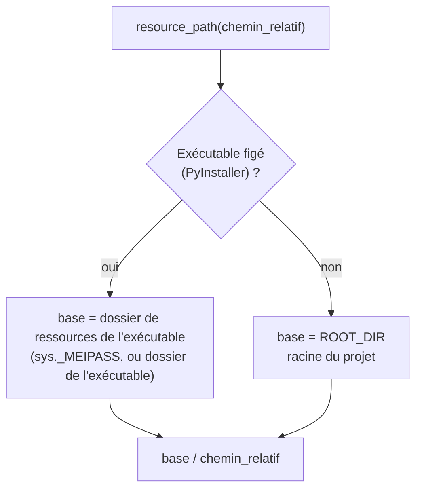

https://pyinstaller.org/en/stable/usage.html
https://pyinstaller.org/en/v6.4.0/runtime-information.html 

---

OUILLE OUILLE OUILLE conflits...

git switch Packaging 
 Pacman_GIT git:(Packaging) git merge main      
Auto-merging src/__main__.py
CONFLICT (content): Merge conflict in src/__main__.py
Auto-merging src/game/entities/ghost.py
Auto-merging src/game/entities/ghost_manager.py
Auto-merging src/game/entities/player.py
Auto-merging src/game/game.py
CONFLICT (content): Merge conflict in src/game/game.py
Auto-merging src/game/gums/pacgum_manager.py
Auto-merging src/game/gums/super_pacgum.py
Auto-merging src/menu/main_menu.py
Auto-merging src/utils/sprites.py
CONFLICT (content): Merge conflict in src/utils/sprites.py
Auto-merging src/utils/utils.py
CONFLICT (content): Merge conflict in src/utils/utils.py
Automatic merge failed; fix conflicts and then commit the result.

---

### Arborescence OK

Dossiers `modules/` et `assets/` en dehors de `src/` : OK, bonne architecture

- `src/` 
  contient uniquement le code source du jeu. 
- `assets/`
  contient les ressources graphiques.
- `modules/`
  contient les dépendances locales `.whl`.

=> Structure propre, à priori facile à packager...
... MAIS des problèmes de chemin peuvent se produire avec PyInstaller, à cause de l'arborescence du projet qui change quand le script Python est transformé en exécutable (*gelé/frozen*).


## `--onedir` vs `--onefile`

Avec **PyInstaller**, les modes `--onefile` et `--onedir` définissent la façon dont le programme et ses dépendances (bibliothèques, fichiers DLL, etc.) sont empaquetés dans le dossier `dist/`.

=> il faut choisir entre performances et commodité de distribution :

* **`--onedir`** (par défaut)
	PyInstaller regroupe l'appli et ses dépendances dans un dossier pour un démarrage rapide
	-`/+\` Démarrage instantané car les fichiers sont déjà décompressés ;
	-`/+\` Moins de soucis avec les antivirus, car les fichiers sont visibles et plus facilement validés par les systèmes de sécurité ;
	-`/+\` Mises à jour plus faciles, on peut modifier un petit composant sans tout re-faire ;
	-`/-\` Pour le partager, il faut généralement le zipper ou créer un vrai programme d'installation.

* **`--onefile`** (pas forcément plus simple)
	PyInstaller compresse tout (script, interpréteur Python, bibliothèques...) dans **1 seul fichier exécutable** autonome qui doit se décompresser à chaque lancement
	-`/+\` Très facile à partager, propre et rapide à distribuer ;
	-`/-\` Lancement plus lent (doit décompresser tout à chaque démarrage) ;
	-`/-\` Faux positifs antivirus ;
	-`/-\` Plus difficile à déboguer si des fichiers de données manquent.


Pour Itch.io, il est conseillé est d'utiliser `--onedir`, puis de zipper le dossier obtenu avant de l'uploader :
- Les joueurs d'Itch.io sont frileux face aux fichiers `.exe` uniques et inconnus... qu'ils ne peuvent pas explorer.
- Les mises à jour sont ultra-légères, Itch ne téléchargera QUE les fichiers modifiés (vs l'intégralité de l'exécutable avec `--onefile`).
- Les dossiers des fichiers externes (sprites, musiques, polices...) peuvent rester visiblement stockés à côté de l'exécutable, plus simple à gérer dans le code Python... *à condition de l'avoir anticipé :P*.


## `sys._MEIPASS` 

Quel que soit le mode choisi, une variable `sys._MEIPASS` est créée par PyInstaller dès que le script est *gelé*.

```text
dist/PacMan/
├── PacMan.exe          ← sys.executable
└── _internal/          ← sys._MEIPASS (dépendances ET fichiers de données)
    ├── data/
    └── ...
```

- mode `--onedir` :
	`sys._MEIPASS` pointe simplement vers le sous-dossier `_internal` de l'application généré par PyInstaller

- mode `--onefile` :
	`sys._MEIPASS` pointe vers un dossier temporaire caché (créé dynamiquement dans le système et supprimé automatiquement à la fermeture du programme).


## `paths.py` pour retrouver les fichiers partout

Un jeu doit retrouver ses images (`assets/`) et ses données (`config.json`, `highscores.json`). Un chemin comme `"assets/Walls/0000.png"` ne marche que si le programme est lancé **depuis le bon dossier**. Il faut en plus que cela fonctionne **dans l'exécutable PyInstaller**, où les fichiers sont rangés ailleurs.

Soluce :


### trouver la racine
En partant de l'emplacement du fichier lui-même (`paths.py` → `utils` → `src` → racine) au lieu du dossier courant,
le projet se lance correctement quel que soit l'endroit d'où on tape la commande, ie *ancrage absolu*.
```python
# parents[2] pour remonter l'arbo: paths.py -> utils -> src -> racine du projet
ROOT_DIR = Path(__file__).resolve().parents[2]
```

### Assets et `resource_path()`
PyInstaller ajoute l'attribut `frozen` à `sys` dans un exécutable, `getattr` avec une valeur par défaut évite une erreur quand il n'existe pas (exécution normale)
```python
def resource_path(relative_path: str) -> Path:
    """Chemin d'une ressource, en dev comme dans le build PyInstaller.
    ARG: nom du fichier recherché
    RETURN: objet issu du module `pathlib`
    """
    if getattr(sys, "frozen", False):
        # En mode figé, sys._MEIPASS pointe vers dist/PacMan/_internal
        base_path = Path(getattr(sys, "_MEIPASS", Path(sys.executable).parent))
    else:
        # En dev, Ancrage absolu :D
        base_path = ROOT_DIR
    return base_path / relative_path
```

### Config et `resolve_path()`
```python
def resolve_path(arg: str) -> Path:
    given = Path(arg)
    # le joueur a donné un vrai fichier : on l'utilise
    if given.is_file():
        return given
    # sinon on cherche une version embarquée
    bundled = resource_path(arg)
    # au pire, le chemin d'origine sera géré par `get_valid_config` qui reverra la config par défaut.
```

`/!\` ne pas oublier d'inclure les dossiers de ressources lors du build

# `PacMan.spec` commenté

```python
# Indique à l'éditeur de texte la coloration syntaxique à utiliser et force l'encodage en UTF-8
# -*- mode: python ; coding: utf-8 -*-

# fonction utilitaire indispensable pour les bibliothèques tierces complexes qui possèdent des fichiers non-Python
from PyInstaller.utils.hooks import collect_all

# Définit les fichiers externes (images, sons, bdd) à copier dans le dossier final
# liste de tuples respectant le format `('chemin_source', 'dossier_destination_interne')`
datas = [('src/data/config.json', 'src/data'), ('assets', 'assets')]
# forcer l'inclusion de bibliothèques dynamiques (comme des `.dll` ou des `.so`)
binaries = []
# déclarer les modules Python que le code utilise de façon dynamique
hiddenimports = []
# scanner intégralement la biblio `mlx`, notoirement difficile à packager car elle dépend de bibliothèques compilées.
# collect_all retourne un tuple contenant tout ce qu'il faut embarquer
tmp_ret = collect_all('mlx')
# Concatène les éléments découverts pour `mlx` aux 3 listes
datas += tmp_ret[0]; binaries += tmp_ret[1]; hiddenimports += tmp_ret[2]


# moteur de PyInstaller : l'objet `Analysis` prend le point d'entrée 'run.py' et trace tout l'arbre des dépendances
# (imports, imports des imports, etc.)
# On y injecte directement les listes configurées précédemment (datas, binaries, hiddenimport).
# Les autres paramètres sont laissés vides ou par défaut.
a = Analysis(
    ['run.py'],
    pathex=[],
    binaries=binaries,
    datas=datas,
    hiddenimports=hiddenimports,
    hookspath=[],
    hooksconfig={},
    runtime_hooks=[],
    excludes=[],
    noarchive=False,
    optimize=0,
)
# compile en .pyc tous les scripts Python purs identifiés à l'étape précédente, puis les zippe en .pyz
# pour réduire la taille, accélérer le chargement et masquer un peu le code.
pyz = PYZ(a.pure)

# Prépare la création du fichier exécutable qui servira de lanceur
exe = EXE(
    pyz,
    a.scripts,
    [],
    # build --onedir (avec plein de fichiers) et non --onefile (1 seul gros exécutable)
    exclude_binaries=True,
    # nom de l'exécutable
    name='PacMan',
    # mis à True pour trouver la source des bugs
    debug=False,
    bootloader_ignore_signals=False,
    strip=False,
    upx=True,
    # maintenir le terminal ouvert derrière la fenêtre du jeu
    console=True,
    disable_windowed_traceback=False,
    argv_emulation=False,
    target_arch=None,
    codesign_identity=None,
    entitlements_file=None,
)
# étape finale pour l'empaquetage en dossier (cf --onedir :
# rassemble l'exécutable, les dépendances compilées (`a.binaries`) et les fichiers statiques (`a.datas`)
# pour construire la structure finale dans le dossier `/dist/PacMan/`.
coll = COLLECT(
    exe,
    a.binaries,
    a.datas,
    strip=False,La recommandation absolue
    upx=True,
    upx_exclude=[],
    name='PacMan',
)
```
