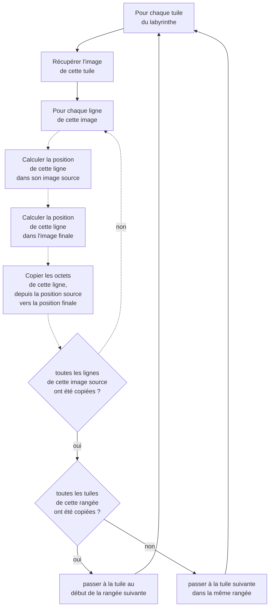

# `bake_background()`
Méthode qui assemble toutes les tuiles du labyrinthe en une seule image d'arrière-plan.

### Problème

Soit un labyrinthe de 15×15 tuiles, donc 225 images piochées parmi 16 différentes (cf position des murs).

Pour dessiner le labyrinthe, faire 225 appels à chaque frame était problématique : toutes les tuiles n'étaient pas encore affichées quand on passait à la frame suivante...

### Solution envisagée

Assembler toutes ces images de 48x48 pixels, pour obtenir 1 seule image de 720x720 pixels qu'on peut afficher à chaque frame avec 1 seul appel.

### Difficulté rencontrée

Un simple `memcpy` ne convient pas car une image MLX est stockée en mémoire comme une suite d'octets, ligne par ligne.
Schématiquement, pour une image de 2x3 pixels, on stocke 2 lignes :
```
octet	|	octet	|	octet
-----------------------------
octet	|	octet	|	octet
```

Et donc, schématiquement, pour une image finale composée de 4 images `A`, `B`, `C` et `D` de taille 2x3 :
```
visuellement 4 images :        en mémoire leurs octets :
 A A A | B B B                 ligne0 : A A A B B B
 A A A | B B B                 ligne1 : A A A B B B
 -------------                 ligne2 : C C C D D D
 C C C | D D D                 ligne3 : C C C D D D
 C C C | D D D
```
=> dans l'image finale, les lignes d'une tuile ne sont **pas contiguës** :
entre la ligne n et la ligne n+1 de la 1ère tuile d'une rangée, il faut intercaler la ligne n de toutes les tuiles de la même rangée.

### Algo



### Méthode `bake_background()`
*Code ébauché par l'esclave IA, puis modifié et commenté par les bipèdes esclavagistes :P*
```python
# toutes les dimensions (width, height, size...) sont en pixels
def bake_background(self, nb_tiles_across: int, nb_tiles_up: int, side_tile_size: int = 48) -> int:
	# taille en pixels de l'image finale (background)
	bg_width = nb_tiles_across * side_tile_size
	bg_height = nb_tiles_up * side_tile_size
	# crée une image MLX vide de la bonne taille
	bg_img = mlx.get_tools().mlx_new_image(mlx.mlx_ptr, bg_width, bg_height)
	
	# bg_addr: pointeur vers le début du tampon de pixels du background
	# mlx_bits_per_px: nb bits par pixel de ce contexte MLX
	# bg_nb_bytes_in_row: nb octets par ligne du background (peut inclure du padding)
	bg_addr, mlx_bits_per_px, bg_nb_bytes_in_row, _ = mlx.get_tools().mlx_get_data_addr(bg_img)
	
	# conversion des bits en octets, avec // car les bornes d'un slice exigent des entiers
	bytes_per_px = mlx_bits_per_px // 8
	# nb d'octets à copier par ligne de tuile
	nb_bytes_in_tile_row = side_tile_size * bytes_per_px
	# coordonnées du pixel par lequel on commencera la copie (en haut à gauche)
	x, y = 0, 0

	# pour chaque ligne de tuile dans le background
	for i in range(nb_tiles_up):
		# pour chaque colonne de tuile dans le background
		for j in range(nb_tiles_across):
			# trouve le pattern de mur pour cette tuile :
			code = self.smaze[i][j]["code"]
			# précharge l'image correspondante :
			tile_img = WALLS[code][0]
			
			# tile_addr: pointeur vers le début du tampon de pixels de cette tuile
			# tile_nb_bytes_in_row: nb octets par ligne de la tuile (peut inclure du padding)
			tile_addr, _, tile_nb_bytes_in_row, _ = (mlx.get_tools().mlx_get_data_addr(tile_img))

			# pour chaque ligne dans l'image source (tuile)
			for line in range(side_tile_size):
				# position du début de cette ligne dans la tuile
				src_start = line * tile_nb_bytes_in_row
				# tous les octets de cette ligne
				src_bytes = tile_addr[src_start:src_start + nb_bytes_in_tile_row]

				# position pour cette ligne dans l'image destination (background)
				dst_start = (y + line) * bg_nb_bytes_in_row + x * bytes_per_px
				# colle les octets de la tuile dans le background
				bg_addr[dst_start:dst_start + nb_bytes_in_tile_row] = src_bytes
			# décale vers la droite pour la tuile suivante dans cette rangée du background
			x += side_tile_size
		# descend au début de la rangée suivante dans le background
		x = 0
		y += side_tile_size

	# identifiant du background assemblé, prêt à être affiché d'1 seul appel
	return bg_img
```

# NOTES 

### Bits par pixel
nombre de bits utilisés pour coder la couleur d'**un seul pixel**.

Sur les systèmes modernes (et donc avec MLX/X11), c'est presque toujours **32 bits** :
+ 8 bits pour le canal Bleu,
+ 8 bits pour le canal Vert,
+ 8 bits pour le canal Rouge,
+ 8 bits pour le canal Alpha (même si inutilisé, car les proc. et cartes graph. manipulent plus efficacement des blocs de 32 bits alignés que des blocs de 24 bits).

### Octets par ligne ("*stride*" ou "*pitch*")
nombre d'octets à parcourir pour passer du début d'une ligne au début de la suivante : dans une image stockée en mémoire, tous les pixels d'une même ligne sont mis bout à bout, puis on enchaîne avec la ligne suivante.

**Exemple** d'une image de 48 pixels de large en 32 bpp (4 octets/pixel) :
```
48 × 4 = 192 octets de pixels par ligne

ligne 0 : [ 192 octets de pixels ]
ligne 1 : [ 192 octets de pixels ]
```

`/!\` il n'est pas garanti que `line = largeur × bytes_per_pixel` soit juste, une ligne peut inclure du "*padding*" :<br>
beaucoup de bibliothèques/matériels graphiques exigent que chaque ligne d'une image commence à une **adresse mémoire alignée** sur une certaine taille (multiple de 4, 8 ou 16 octets), pour des raisons de performance : le processeur et la carte graphique lisent la mémoire par blocs, et lire un bloc mal aligné est plus lent voire impossible sur certaines architectures.<br>
=> Si `largeur × bytes_per_pixel` ne tombe pas pile sur cet alignement, la bibliothèque **ajoute des octets inutilisés en fin de ligne** pour que chaque ligne suivante démarre bien alignée.

**Exemple** d'une image de 47 pixels de large sur un système exigeant un alignement sur 4 octets :
```
ligne 0 : [ 188 octets de pixels ][ 4 octets de padding, ignorés ]
ligne 1 : [ 188 octets de pixels ][ 4 octets de padding, ignorés ]
```

A noter : `mlx_get_data_addr()` renvoie la VRAIE valeur (192), padding compris, pas la valeur théorique (188) qu'on obtient en calculant `largeur × bytes_per_pixel` et qui est fausse quand il y a du padding.

### Conversion bits vers octets
conversion indispensable car l'adressage mémoire se fait en octets.

`/!\` on utilise la division entière pour `bytes_per_px = bg_bpp // 8` car le résultat doit être un entier : il va servir de borne dans un slice.

A noter :
- soit on est sur un environnement graphique en 24 ou 32 bpp, alors l'opération `//8` donne le bon résultat
- soit on est sur un environnement graphique "exotique", alors l'opération `//8` donne un résultat silencieusement faux (copies mal dimensionnées, donc image visuellement corrompue)

### `mlx_get_data_addr()` 
```python
img_addr, mlx_bits_per_px, img_nb_bytes_in_row, _ = mlx.get_tools().mlx_get_data_addr(img)

# img_addr:				pointeur vers le début du tampon de pixels de cette image
# mlx_bits_per_px:		nb bits par pixel du contexte MLX
# img_nb_bytes_in_row:	nb octets par ligne de cette image (peut inclure du padding)
```

Il faut bien distinguer deux notions différentes :

- `mlx_bits_per_px` est le *format* de pixel<br>
  il dépend de la configuration graphique de l'affichage (le "visual" X11) utilisée par **tout le contexte MLX** (`mlx_ptr`) :<br>
  toutes les images créées ou chargées dans une même session partagent le même bpp, c'est une propriété globale de la session graphique.<br>
  => on le récupère **1 seule fois**, il est valable pour toutes les images de la session.

- `img_nb_bytes_in_row` est la *mise en page mémoire*<br>
  elle dépend de la largeur de chaque image (y compris un éventuel padding) :<br>
  deux images de largeurs différentes auront généralement un `img_nb_bytes_in_row` différent.<br>
  => on le récupère **pour chaque image**, il est propre à chaque largeur.
